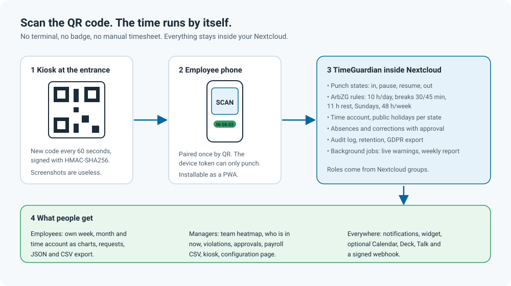
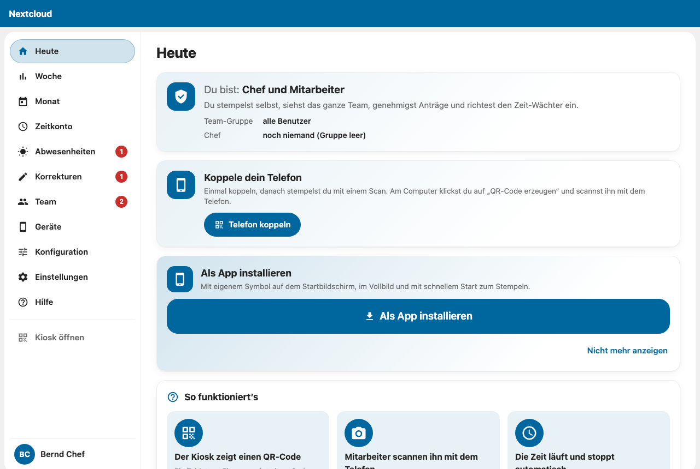
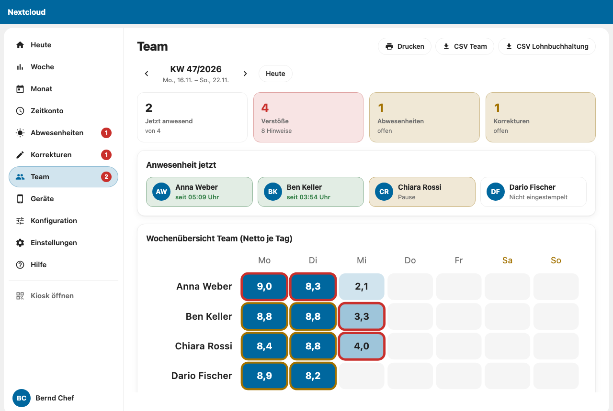
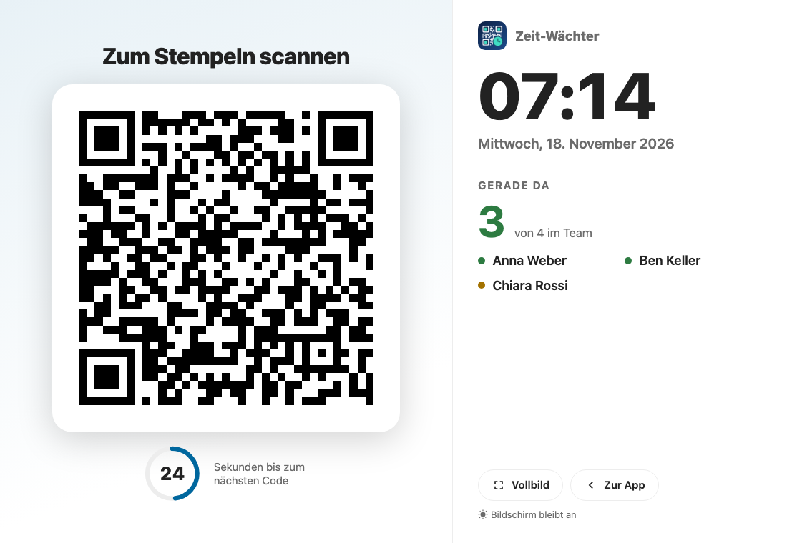
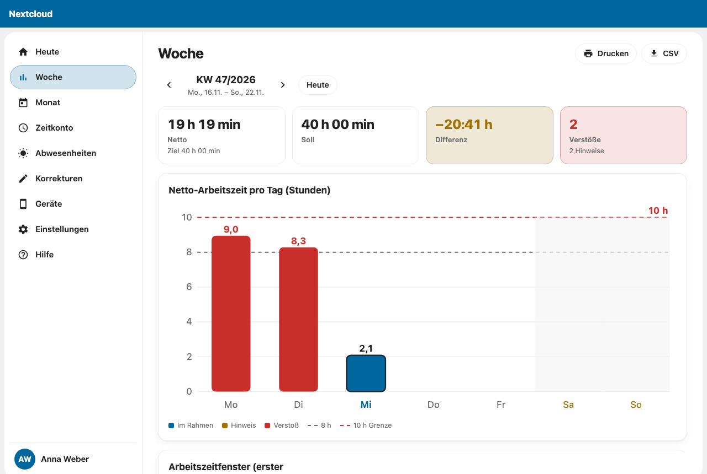
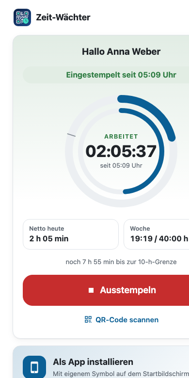
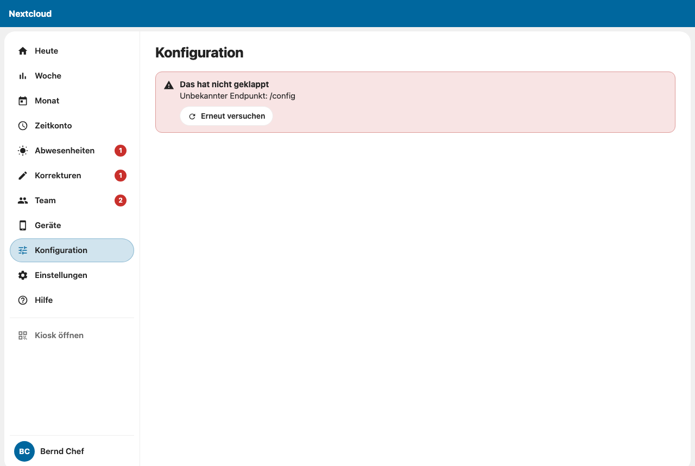

# TimeGuardian

**Working time tracking for Nextcloud: scan a QR code and the clock runs.**
A native Nextcloud app (PHP + vanilla JS, no build step, no external service) that records working time, checks it against the German working time act (ArbZG) and shows charts, notifications and exports. Nextcloud 31 to 35, PHP 8.1+, AGPL-3.0-or-later.



## Screenshots

| Start page for managers | Team heatmap |
| --- | --- |
|  |  |

| Kiosk with the rotating QR code | Week chart |
| --- | --- |
|  |  |

| Installed phone app | Configuration for managers |
| --- | --- |
|  |  |

(Screenshots show demo data.)

## How it works

1. **Kiosk.** A tablet at the entrance opens `/apps/timeguardian/kiosk` and shows a QR code. The code rotates every 60 seconds and is signed with HMAC-SHA256, so a screenshot is useless a minute later.
2. **Pair the phone once.** An employee opens the app on a computer, goes to *Devices* and shows the pairing QR code (valid for 5 minutes, single use). The phone scans it and receives a device token. The token can only clock in and out and read the own status. It gives no access to Nextcloud. Tokens are stored as SHA-256 hashes, last 180 days (renewed on use) and can be revoked at any time.
3. **Scan to clock in and out.** Scanning the kiosk code starts the time, the next scan stops it (or switches pause/resume, depending on the chosen mode). Double scans within two minutes are rejected.
4. **Rules and views.** The app builds time entries, checks the ArbZG rules and shows the results to the employee (week, month, time account) and to managers (team heatmap, who is in now, violations, approvals).

The phone can install the app as a PWA. Its start page is `/apps/timeguardian/go`: status, a big *Scan QR code* button and pause/resume/end. The full interface is the normal Nextcloud web app.

## Features

- Rotating, signed kiosk code and revocable device tokens
- ArbZG rules: 10 h per day (§ 3), 8 h notice, breaks of 30/45 min (§ 4), 11 h rest (§ 5), Sundays (§ 9), 48 h per week, absence notice
- Time account with overtime balance, public holidays for all 16 federal states, part-time targets
- Absences (vacation, sick, flex time, business trip) with manager approval and calendar entry
- Correction requests with manager approval and an append-only change log
- Live warnings as Nextcloud notifications (9 h 30, 5 h 45 without a break, forgotten clock-out) and a weekly report for managers
- Charts as plain SVG: week, month, time account, team heatmap; print view
- CSV and JSON export, payroll CSV with formula-injection protection
- Dashboard widget, optional Calendar, Deck and Talk integration, optional signed webhook (for n8n, Zapier and similar)
- Privacy: configurable retention (default 2 years), data removed when the user is deleted, personal data export
- Languages: English, German, Italian

## Install

Requirements: Nextcloud 31 to 35, PHP 8.1 or newer, working background jobs (cron recommended, live warnings run every 5 minutes).

**From a release (recommended).** Download `timeguardian-<version>.zip` from the [Releases](../../releases) page, then:

```bash
cd /var/www/nextcloud/custom_apps          # any apps_paths entry of your config.php
unzip /path/to/timeguardian-<version>.zip  # creates the folder timeguardian
chown -R www-data:www-data timeguardian
sudo -u www-data php /var/www/nextcloud/occ app:enable timeguardian
```

**From source.**

```bash
git clone <URL of this repository> timeguardian
cd timeguardian && bash bin/pack.sh        # builds dist/timeguardian-<version>.zip, then unzip as above
```

Docker (Nextcloud AIO or similar): copy the folder into the container's `custom_apps`, `chown` it to `www-data`, then `docker exec -u www-data <container> php occ app:enable timeguardian`.

### First steps

1. Create the groups and add people (the names are the defaults and can be changed by a Nextcloud admin in *Administration settings → TimeGuardian*):
   ```bash
   occ group:add tg-chef
   occ group:add tg-team
   occ group:adduser tg-chef <manager>
   occ group:adduser tg-team <employee>
   ```
2. Open the app. A manager sees a setup checklist on the start page. On the *Configuration* page set federal state (public holidays), time zone, default weekly hours and the optional integrations. Managers do not need Nextcloud admin rights.
3. Open `/apps/timeguardian/kiosk` on the entrance tablet with a manager account, switch the browser to full screen and leave it open.
4. Employees open the app, choose *Devices → Create QR code*, scan it with the phone and install the app. From then on they just scan the kiosk code.

**iPhone note.** An app added to the Home Screen has its own storage, separate from Safari. Add the app first (Safari: Share → Add to Home Screen), open it, and pair **inside** the app with the built-in QR scanner or by typing the short code (`ABCD-EFGH`) shown next to the pairing QR. Pairing done in Safari does not carry over. Pairing in the browser without installing the app also works.

Roles come from Nextcloud groups. Nextcloud administrators are **not** managers automatically.

### Update and uninstall

Unpack the new archive over the old folder and run `occ app:disable timeguardian && occ app:enable timeguardian` (or `occ upgrade`); migrations run automatically and data is kept. `occ app:remove timeguardian` removes the code; the `tg_*` tables stay until you drop them.

More: [docs/INSTALL.md](docs/INSTALL.md) · [docs/ADMIN.md](docs/ADMIN.md) · [docs/PRIVACY.md](docs/PRIVACY.md) · [docs/SECURITY.md](docs/SECURITY.md) · [docs/API.md](docs/API.md)

## Development

```bash
php tests/run.php          # domain and package tests, no Nextcloud needed (PHP 8.1+)
node tests/frontend/run.js # frontend logic and i18n tests
bash bin/pack.sh           # builds dist/timeguardian-<version>.zip
```

`lib/Domain` holds the pure logic without Nextcloud dependencies (rules, holidays, balance, punch state machine, QR signing, tokens, CSV). `lib/Service` orchestrates, `lib/Db` has entities, mappers and the migration, `lib/Controller` the HTTP layer, `lib/Cron` the background jobs. Shared test vectors are in `tests/vectors`.

## Notes

The rule checks are an aid and not legal advice. Check your own obligations (works council, local law, collective agreements).

## License

AGPL-3.0-or-later, see [LICENSE](LICENSE).
